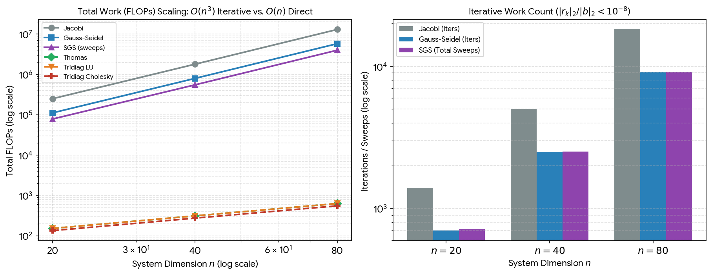

# The 1D Laplacian: Direct vs. Iterative Solvers Benchmark

A numerical linear algebra benchmark comparing **6 structure-exploiting direct and iterative solvers** on the 1D discrete Laplacian $A_n = \mathrm{tridiag}(-1, 2, -1) \in \mathbb{R}^{n \times n}$ with right-hand side $b = A_n \mathbf{1}$ (exact solution $x_* = \mathbf{1}$) across $n \in \{20, 40, 80\}$.

## How Each Solver Exploits Matrix Structure

### 1. Banded Direct Solvers ($O(n)$ Total Work & Storage)
- **Thomas Algorithm**: Specialized Gaussian elimination for tridiagonal systems that tracks only the single superdiagonal and modified right-hand side, avoiding $O(n^3)$ dense operations and guaranteeing zero fill-in in **$8n - 7$ FLOPs**.
- **Tridiagonal LU Factorization**: Exploits the strict bandwidth of $A_n$ so that $L$ is unit lower bidiagonal and $U$ is upper bidiagonal ($1$ subdiagonal + $1$ diagonal stored as 1D vectors), requiring **$8n - 7$ FLOPs** including factorization and triangular solves.
- **Tridiagonal Cholesky Factorization ($A_n = L L^\top$)**: Further exploits symmetry and positive definiteness (SPD) of $A_n$, producing a single lower bidiagonal factor $L$ and reducing total work to **$7n - 5$ FLOPs** (with $n$ square roots).

### 2. Stationary Iterative Solvers ($O(n^3)$ Total Work)
- **Jacobi**: Uses the 3-point stencil $x_i^{(k+1)} = \frac{1}{2}(b_i + x_{i-1}^{(k)} + x_{i+1}^{(k)})$ completely matrix-free ($O(n)$ work per iteration).
- **Gauss-Seidel (GS)**: Updates $x_i$ in-place using the newest left neighbor $x_{i-1}^{(k+1)}$, eliminating the need for an auxiliary vector and doubling asymptotic convergence speed over Jacobi.
- **Symmetric Gauss-Seidel (SGS)**: Performs one forward sweep followed by one backward sweep per outer iteration (restoring symmetry of the preconditioner $M_{\text{SGS}}$), counted explicitly as **2 sweeps** per outer step.

## Spectral Radius & Scaling Analysis

The exact eigenvalues of $A_n$ are $\lambda_j = 2 - 2\cos\left(\frac{j\pi}{n+1}\right)$, giving condition number $\kappa_2(A_n) \approx \frac{4n^2}{\pi^2} = O(n^2)$:

| Dimension $n$ | $\kappa_2(A_n)$ | $\rho(G_{\text{Jacobi}}) = \cos\left(\frac{\pi}{n+1}\right)$ | $\rho(G_{\text{GS}}) = \cos^2\left(\frac{\pi}{n+1}\right)$ | $\rho(G_{\text{SGS}})$ |
| :---: | :---: | :---: | :---: | :---: |
| 20 | `178.1` | `0.98883` | `0.97779` | `0.95715` |
| 40 | `680.6` | `0.99707` | `0.99414` | `0.98840` |
| 80 | `2658.4` | `0.99925` | `0.99850` | `0.99700` |

Because $1 - \rho(G) = O(n^{-2})$, doubling $n$ quadruples the required iteration count ($O(n^2)$ iterations $\times O(n)$ work/iter $= O(n^3)$ FLOPs). Moreover, although SGS halves the outer iteration count relative to GS, each outer step costs **2 sweeps**, so total sweep work remains essentially identical to GS ($9{,}100$ vs. $9{,}085$ at $n=80$).

## Benchmark Results ($x_0 = 0$, Stopping Criterion $\lVert b - A_n x_k \rVert_2 / \lVert b \rVert_2 < 10^{-8}$)

| Solver | $n=20$ Iters/Sweeps | $n=20$ FLOPs | $n=40$ Iters/Sweeps | $n=40$ FLOPs | $n=80$ Iters/Sweeps | $n=80$ FLOPs | $n=80$ Runtime (ms) | $n=80$ Rel. Error |
| :--- | :---: | :---: | :---: | :---: | :---: | :---: | :---: | :---: |
| **Jacobi** | 1,398 | 251,580 | 5,000 | 1,799,880 | 18,167 | 13,080,000 | `411.82` | `1.051e-06` |
| **Gauss-Seidel** | 700 | 112,000 | 2,501 | 800,320 | 9,085 | 5,814,400 | `858.50` | `1.049e-06` |
| **SGS (Total Sweeps)** | 718 | 78,980 | 2,518 | 553,960 | 9,100 | 4,004,000 | `780.01` | `1.050e-06` |
| **Thomas Algorithm** | 1 | 153 | 1 | 313 | 1 | 633 | **`0.097`** | **`6.031e-15`** |
| **Tridiagonal LU** | 1 | 153 | 1 | 313 | 1 | 633 | `0.196` | **`6.129e-15`** |
| **Tridiagonal Cholesky** | **1** | **135** | **1** | **275** | **1** | **555** | `0.322` | **`7.038e-15`** |

*(Note: Iterative relative solution errors degrade as $O(\kappa_2(A_n) \cdot \text{tol})$ with growing $n$, while banded direct solvers maintain $O(10^{-15})$ machine precision at $>6{,}000\times$ lower FLOP cost and $>4{,}000\times$ faster runtime at $n=80$.)*



## Usage

```bash
pip install -r requirements.txt
python laplacian_1d_solvers.py
```
